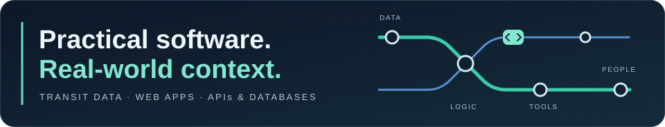
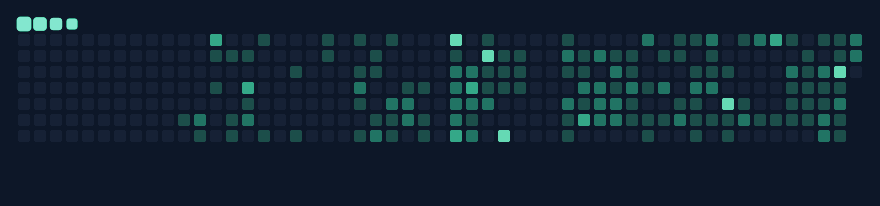
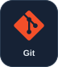
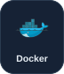
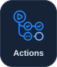

  

<h1 align="center">Hi, I'm Omar Khattab.</h1>

  I build web applications and data tools that make everyday work easier. 
  Computer Science graduate from the University of Ottawa, with hands-on experience in transit operations and data.

  
  

  

Contribution trail · My GitHub activity, refreshed weekly.

## How I work

My projects often start with a practical question: how can this information be easier to find, check, or use?

I connect APIs and databases to clear interfaces, with attention to data integrity, access controls, and the people doing the work. My transit background helps me see the operational details behind a software requirement.

## Languages & tools

  
  
  
  
  
  
  
  
  
  
  
  
  
  
  
  

## Selected work

1. **[GTFS Merge Auditor](https://github.com/Omar-Khattab-01/gtfs-release-validator)** 
   Inspect and reconcile transit feed exports, compare source records with final GTFS, and trace findings back to the affected data.

2. **[GTFS Viewer](https://github.com/Omar-Khattab-01/gtfs-viewer)** · [Live viewer](https://omar-khattab-01.github.io/gtfs-viewer/) 
   Read large GTFS tables in the browser with pinned headings, coloured columns, and links from feed checks to affected rows.

3. **[Project Tracker](https://github.com/Omar-Khattab-01/project-tracker-app)** · [Live app](https://project-tracker-online.web.app) 
   Bring projects, tasks, milestones, and deadlines together in a personal workspace with dashboard and timeline views.

4. **[OC Operator Tools](https://github.com/Omar-Khattab-01/OC-Bus-Tracker)** · [Live app](https://oc-bus-tracker.vercel.app/) 
   Bring live bus lookups, paddles, shuttle schedules, and booking-board references into an operator-focused web app.

5. **[ERO Operator Tools](https://github.com/Omar-Khattab-01/ERO-Operator-Tools)** · [Live app](https://ero-operator-tools.vercel.app/) 
   Support rail-operator paddle lookup, shift reference, saved work, and access-controlled LRV defect reporting.

6. **[Milano's Cash Out](https://github.com/Omar-Khattab-01/milanos-cashout)** 
   Keep employee shifts, driver earnings, cash reconciliation, receipts, and management review together.
